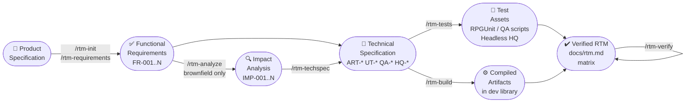
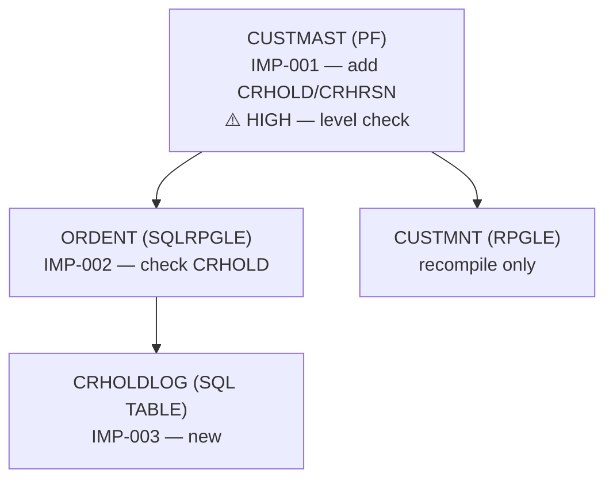

# RTM for IBM i — Bob Workflow Pack + VS Code Extension

> **Requirements traceability for RPGLE / SQLRPGLE / CLLE / DDS / Db2 for i projects, driven entirely by IBM Bob slash commands.**

If you've ever delivered a change to an IBM i application and then struggled to answer *"which program implements FR-15?"* or *"did we test the credit-hold path?"* — this pack is built for you.

---

## What Problem Does This Solve?

IBM i shops frequently deal with:

- **Undocumented brownfield applications** — large RPGLE/CLLE codebases where nobody is sure which program owns which business rule.
- **Level-check ripple effects** — a single `CHGPF` forces recompilation of a dozen callers; tracking them manually is error-prone.
- **Audit requirements** — financial and compliance projects need a traceable path from a written requirement to a compiled object to a test result.
- **Context switching** — developers keep specs in Word, tests in spreadsheets, and source in a library. Nothing is linked.

This pack gives you a single source of truth — `rtm/rtm.json` — and a set of AI-driven slash commands that keep it up to date at every step of development.

---

## Architecture Overview

```
┌────────────────────────────────────────────────────────────────────────┐
│                        IBM Bob / Bob Shell                             │
│                                                                        │
│  ┌─────────────┐  ┌──────────────┐  ┌──────────────┐  ┌───────────┐  │
│  │ rtm-analyst │  │rtm-architect │  │ rtm-builder  │  │  rtm-qa   │  │
│  │   (mode)    │  │   (mode)     │  │   (mode)     │  │  (mode)   │  │
│  └──────┬──────┘  └──────┬───────┘  └──────┬───────┘  └─────┬─────┘  │
│         │                │                 │                 │        │
│    /rtm-init          /rtm-analyze     /rtm-build        /rtm-tests   │
│    /rtm-requirements  /rtm-techspec    /rtm-build        /rtm-verify  │
└─────────────────────────────────┬──────────────────────────────────────┘
                                  │ reads & writes
                        ┌─────────▼──────────┐
                        │   rtm/rtm.json      │  ← single source of truth
                        │  (FR, IMP, ART,     │
                        │   UT, QA, HQ)       │
                        └─────────┬──────────┘
                                  │
              ┌───────────────────┼───────────────────┐
              ▼                   ▼                   ▼
     docs/requirements/   docs/techspec/      tests/{unit,qa,headless}/
     docs/analysis/        docs/rtm.md        qrpglesrc/  qddssrc/ etc.
```

**Two layers, working together:**

| Layer | What it owns | Where it lives |
|---|---|---|
| **Bob modes & commands** | AI reasoning per phase (analyst, architect, builder, QA) | `.bob/custom_modes.yaml`, `.bob/commands/rtm-*.md` |
| **CLI + VS Code extension** | Deterministic gating: ID allocation, validation, build order, matrix view | `out/cli.js`, VS Code extension |

The AI never "remembers" traceability between sessions. It writes to `rtm.json`, and every command ends by running `node .rtm/cli.js validate`, which exits non-zero on any gap. This makes the RTM auditable and CI-gateable.

---

## The Six-Step Workflow



### Greenfield vs. Brownfield

```mermaid
flowchart TD
    Start([/rtm-init]) --> Detect{Existing IBM i\nsource found?}
    Detect -->|Yes: .rpgle .clle\n.pf .dspf etc.| BF[Brownfield path]
    Detect -->|No existing source| GF[Greenfield path]
    BF --> Step1B[/rtm-requirements]
    GF --> Step1G[/rtm-requirements]
    Step1B --> Step2[/rtm-analyze\nImpact analysis required]
    Step1G --> Step3[/rtm-techspec\nskip analyze]
    Step2 --> Step3
```

---

## ID System — The Traceability Spine

Every item in `rtm.json` carries a permanent, never-reused ID:

| Prefix | What it represents | Example |
|---|---|---|
| `FR-nnn` | Functional Requirement | `FR-001` — "Block order entry for held customers" |
| `IMP-nnn` | Impact item (brownfield: existing object that must change) | `IMP-001` — CUSTMAST PF needs two new fields |
| `ART-nnn` | Artifact (source member / SQL object to create or modify) | `ART-003` — ORDENT.sqlrpgle, action: modify |
| `UT-nnn` | RPGUnit unit test | `UT-001` — validateCustomer rejects held customer |
| `QA-nnn` | Manual 5250 QA test script | `QA-001` — Place and release hold via CRHOLD screen |
| `HQ-nnn` | Headless automated test (runs over SSH, no 5250) | `HQ-001` — Order rejected for held customer |

IDs flow through the entire codebase. Source members get a trace header:

```rpgle
**free
// ============================================================
// ART-005  FR-001  FR-003  Generated 2026-10-20
// CRHOLD — Credit hold maintenance program
// ============================================================
ctl-opt dftactgrp(*no) actgrp('CRHOLD') option(*srcstmt:*nodebugio);
```

Changed lines in modified members are tagged inline:

```rpgle
  if custmast.crhold = 'Y';     // FR-002
    sendMsg('ORD0107');
    return *off;
  endif;
```

---

## Product Specification Examples

The product spec is the **only human-authored input** to the workflow. Everything else — requirements, impact analysis, technical specification, source code, and tests — is derived from it by Bob. You feed Bob a spec; Bob builds the traceable chain all the way to compiled objects and test results.

The spec does not need any special format. It can be a Markdown file, a plain text document, a `.docx`, or a `.pdf`. The richer and more precise your spec, the better the requirements Bob derives from it. The examples below use Markdown — the recommended format because it renders in VS Code and Git.

> **Tip for IBM i devs:** The more business rules you spell out explicitly — error messages, field validation, authority checks, batch vs. interactive behaviour — the fewer open questions Bob will raise.

---

### Example 1 — Brownfield: Customer Credit Hold

This is the spec that drives `examples/credit-hold/`. It is a change request against an existing order-entry application.

Place this file at `docs/spec/credit-hold.md`, then run:

```
/rtm-init "Customer Credit Hold" ORDDEV
/rtm-requirements docs/spec/credit-hold.md
```

```markdown
# Product Specification — Customer Credit Hold
Version 1.0 · 2026-10-01 · Author: J. Wilson (Credit Manager)

## 1. Background

The order-entry system (ORDENT) currently allows orders to be placed for any customer
regardless of their credit standing. The credit management team has requested the ability
to place a customer on a manual hold that blocks new orders until the hold is lifted.

## 2. Functional Requirements

### 2.1 Place / release a credit hold

A credit manager (user class CRMGR or authority *ALLOBJ) must be able to:
- Place a customer on credit hold by selecting a reason code from a lookup.
  Valid reason codes: PASTDUE (Past due balance), OVERLMT (Over credit limit),
  DISPUTE (Payment dispute), OTHER (requires a free-text note ≤ 60 chars).
- Release a credit hold. The release must also require a reason (PAID, RESOLVED, OTHER).
- Both actions must write an audit row to a new hold log table with:
  customer number, action (HOLD/RELEASE), reason code, note, operator user profile,
  workstation name, timestamp.

A customer can only be on one active hold at a time.
Attempting to place a hold on an already-held customer is an error (message CRH0001).
Attempting to release a customer who is not on hold is an error (message CRH0002).

### 2.2 Block order entry for held customers

When ORDENT attempts to create an order header for a customer who is on credit hold:
- The order must NOT be written to ORDHDR.
- Message ORD0107 must be shown: "Customer &1 is on credit hold. Contact the credit department."
- The operator must be able to press F12 to cancel or F10 to view the hold history
  (invoking the hold inquiry from §2.3 as a pop-up).

This check applies to both interactive order entry (5250 screen) and to batch order
import (the ORDIMPCL CL program that calls ORDINP).

### 2.3 Hold history inquiry

Any operator (no special authority required) must be able to:
- Inquiry a customer's hold history from the customer master screen (CUSTMNT, option 9)
  or by calling the new inquiry program directly.
- View a subfile of all hold/release rows for the customer, newest first, showing:
  date/time, action, reason code, note (truncated to 40 chars with an indicator if longer),
  operator, workstation.
- Press F11 to toggle between summary (20 rows, no note) and detail (10 rows, with note).
- Press Enter on a row to see the full note in a pop-up window.

No add/change/delete — inquiry only.

## 3. Non-functional Requirements

- All new and modified objects compile with DBGVIEW(*SOURCE) for serviceability.
- The hold log table must retain rows for at least 7 years (do not add a purge routine now).
- Authority: CRMGR class has *CHANGE to CUSTMAST and *USE to the new inquiry screen.
  All other classes retain existing authority; no authority changes to ORDENT.
- Performance: the hold check in ORDENT must add no more than 10 ms to order entry
  (the check is a single-row SQL SELECT against a primary key).

## 4. Out of Scope

- Automatic credit hold based on balance or ageing (future release).
- Integration with accounts-receivable aging report (future release).
- Changes to the CUSTMNT maintenance program other than adding option 9.

## 5. Open Questions (for analyst to flag)

- Q1: Should held-customer orders be saved as "pending" rather than rejected outright?
      (Decision required from credit manager before spec is approved.)
- Q2: Is ORDIMPCL the only batch path that calls ORDINP, or are there other callers?
      (Developer to confirm with DSPPGMREF before impact analysis.)
```

---

### Example 2 — Greenfield: Employee Payroll Deduction Maintenance

A brand-new application — no existing source. Place at `docs/spec/payroll-deductions.md`, then run:

```
/rtm-init "Payroll Deductions" HRDEV
/rtm-requirements docs/spec/payroll-deductions.md
```

```markdown
# Product Specification — Employee Payroll Deduction Maintenance
Version 1.0 · 2026-10-15 · Author: S. Patel (HR Systems)

## 1. Background

Payroll deductions (union dues, benefit premiums, garnishments) are currently entered
directly into the payroll system by the payroll team after receiving paper forms from HR.
This project creates an HR-facing maintenance application so HR staff can manage
deductions directly, reducing data-entry lag and transcription errors.

## 2. Actors

| Actor | Description |
|-------|-------------|
| HR Specialist | Adds, changes, and inactivates deductions. No delete. |
| HR Supervisor | All HR Specialist rights plus the ability to approve garnishments. |
| Payroll Auditor | Read-only access to all deductions and history. |

## 3. Functional Requirements

### 3.1 Deduction type master

HR Supervisors can maintain a table of deduction types:
- Fields: type code (4 chars), description (30 chars), calculation method
  (FLAT = fixed amount, PCT = percentage of gross), GL account (10 chars),
  active/inactive flag, effective date.
- Deduction type codes must be unique.
- An inactive deduction type cannot be assigned to a new employee deduction,
  but existing active employee deductions of that type continue to process.
- Minimum screen: list (subfile, 15 rows) with Add (F6), Change (Enter), Inactivate (F23).

### 3.2 Employee deduction assignment

HR Specialists can assign deductions to employees:
- An employee deduction record links: employee number (from EMPMAS), deduction type,
  start date, end date (optional), amount or percentage, frequency
  (WEEKLY, BIWEEKLY, MONTHLY, ONESHOT).
- One-shot (ONESHOT) deductions process on the next payroll run only and then
  automatically set their end date to that run date.
- An employee can have multiple active deductions of different types simultaneously.
  They cannot have two active deductions of the same type at the same time.
  Attempting to add a duplicate raises message DED0003.
- Amount must be > 0. For PCT method, amount must be between 0.01 and 100.00.

### 3.3 Garnishment approval

A garnishment (deduction type with method GARN) requires supervisor approval before
it becomes active. Workflow:
1. HR Specialist creates the deduction record (status = PENDING).
2. HR Supervisor sees pending garnishments flagged on their menu (a count in the
   status bar of the main HR menu).
3. HR Supervisor opens the approval screen, reviews, and approves (ACTIVE) or
   rejects (REJECTED with a mandatory 60-char reason).
4. The employee record is not visible on payroll export until status = ACTIVE.

### 3.4 Payroll export

A batch CL program runs at payroll cut-off:
- Selects all ACTIVE employee deductions whose frequency matches the current
  payroll period type and whose start date ≤ run date and (end date is null or ≥ run date).
- Writes one row per deduction to PAYDED export file (employee, type, amount, frequency,
  run date). This file is consumed by the existing payroll system; do not change its format.
- After a successful write, sets ONESHOT deductions' end date to the run date.
- Writes a summary spool file: total rows, total amount by deduction type, run date/time.

### 3.5 Change history

Every add, change, inactivation, or approval action must write a history row:
employee number, deduction type, field changed, old value, new value,
operator, timestamp. HR Supervisors and Payroll Auditors can view history
per employee or per deduction type (inquiry only).

## 4. Non-functional Requirements

- Release: IBM i 7.5, SQL naming convention, UTF-8 job CCSID.
- All tables: SQL DDL, system name ≤ 10 chars, primary key, audit columns
  (CRTBY, CRTTS, CHGBY, CHGTS).
- Object naming prefix: HR (e.g. HRDEDT, HRDEDR, HRDEDCL).
- 5250 screens: 24×80, INDARA, F3=Exit, F12=Cancel, F1=Help on key fields.
- No hardcoded library names; use the job's library list.
- The payroll export CL (HRPAYEX) must be submittable via SBMJOB with no interactive prompts.

## 5. Out of Scope

- Payroll calculation (handled by existing payroll system).
- Employee master maintenance (read-only access to EMPMAS).
- Benefits enrolment workflow.

## 6. Assumptions

- EMPMAS (employee master PF) already exists in the production library list and contains
  EMPNO (7,0), EMPNAM (40A), DEPT (6A), STATUS (1A: A=active, T=terminated).
- Terminated employees (STATUS='T') can still have deductions processed (some garnishments
  continue after termination); the system should not block entry for terminated employees.
```

---

### What Makes a Good Spec for Bob

| ✅ Include | ❌ Avoid |
|---|---|
| Exact field names, lengths, and types | Vague terms like "some validation" |
| Error message IDs (ORD0107, CRH0001) | Leaving errors undefined ("show an error") |
| Authority requirements (user class, \*ALLOBJ) | Implementation details like program names |
| Batch vs. interactive distinction | Assumptions about how Bob will structure the code |
| Explicit out-of-scope items | Implicit exclusions |
| Screen layout hints (subfile size, function keys) | Detailed screen mockups (Bob builds those) |
| Existing object names Bob should reference | Undocumented dependencies |
| Numbered sections with anchors (§2.1) | Unstructured prose with no sections |

The section references (`spec §2.1`) become the `source` field on each FR in `rtm.json`, which is how every requirement stays linked back to the original business intent.

---


## Slash Commands — Step by Step

### Step 0 · `/rtm-init <project-name> <dev-library>`

**Mode:** `rtm-analyst` &nbsp;|&nbsp; **Who does the work:** Bob

Bob scans your workspace for `*.rpgle`, `*.sqlrpgle`, `*.clle`, `*.pf`, `*.lf`, `*.dspf`, `*.prtf`, `*.sql`, `iproj.json`, `Rules.mk` and similar. Any existing IBM i source → **brownfield**. A blank project → **greenfield**.

**What you get:**
- `rtm/rtm.json` created and seeded with your project name and dev library
- Folder scaffolding: `docs/spec/`, `docs/requirements/`, `docs/analysis/`, `docs/techspec/`, `tests/unit/`, `tests/qa/`, `tests/headless/`
- Bob warns you if the library name looks like a production library (no DEV/TST marker)

> ⚠️ **IBM i safety rule:** Bob refuses to compile into or delete objects from any library that isn't your declared development library. This is enforced across all modes.

---

### Step 1 · `/rtm-requirements <path-to-spec>`

**Mode:** `rtm-analyst` &nbsp;|&nbsp; **Input:** a product spec (`.md`, `.txt`, `.docx`, `.pdf`)

Bob reads the entire specification and:

1. Flags **ambiguities and open questions** without inventing answers — missing acceptance criteria mean the requirement stays in `draft` status
2. Decomposes the spec into **atomic, testable requirements** — one behaviour each, with no program names (implementation-free)
3. Writes each FR with: title, description, source section, priority (`must`/`should`/`could`), and 2–5 **Given/When/Then acceptance criteria** with concrete data values
4. Appends them to `rtm/rtm.json` and writes `docs/requirements/functional-requirements.md`

**What you get:**
```
docs/requirements/functional-requirements.md   ← human-readable requirements doc
rtm/rtm.json                                   ← FR-001..N added, status: draft
```

**Example FR in rtm.json:**
```json
{
  "id": "FR-002",
  "title": "Block order entry for held customers",
  "description": "Order entry rejects new orders for customers on hold.",
  "source": "spec §2.2",
  "priority": "must",
  "acceptanceCriteria": [
    "Given customer 1001 is on hold, when an order is entered, then message ORD0107 is shown and no ORDHDR row is created"
  ],
  "status": "draft"
}
```

Bob asks for your review. When you approve, statuses flip to `approved`.

---

### Step 2 · `/rtm-analyze` *(brownfield projects only)*

**Mode:** `rtm-architect` &nbsp;|&nbsp; **Read-only: Bob does not modify your application source**

This is the most IBM i-specific step. Bob inventories your entire existing application:

```
Programs   ORDENT CUSTMNT CRHIST …
Modules    CUSTVAL ORDVAL …
PFs/LFs    CUSTMAST ORDERHDR ORDERDET …
DSPFs      CRMNTD ORDENTD …
PRTFs      ORDRPT …
CL         ORDCL CRMNTCL …
SQL tables CRHOLDLOG …
```

For each approved requirement, Bob determines **which existing objects must change**, including:

- **Level-check ripple effects** — if CUSTMAST.PF gets a new field, every program that opens it must be recompiled. Bob lists all of them as callers on the IMP item.
- **Call chains** — `CALL`/`CALLP`/`EXTPGM`/`EXTPROC` references tracked through RPGLE and CL source
- **File dependencies** — `dcl-f`, `F-specs`, `EXTNAME`, `LIKEREC`, embedded SQL table references, LF `PFILE`

If you have a live IBM i connection via Code for IBM i / MCP, Bob can confirm facts from the system itself (`DSPPGMREF`, `DSPDBR`, `QSYS2.SYSTABLEDEP`).

**What you get:**
```
docs/analysis/impact-analysis.md              ← inventory, Mermaid call graph, risk table
rtm/rtm.json                                  ← IMP-001..N added with callers, risk, levelCheck
```

**Example impact analysis Mermaid graph (generated by Bob):**


---

### Step 3 · `/rtm-techspec`

**Mode:** `rtm-architect` &nbsp;|&nbsp; **Must validate to 0 errors before `/rtm-build` can proceed**

Bob writes the executable technical specification — a document detailed enough that a builder (human or AI) can generate every artifact from it without guessing.

For each object it covers:

| Object type | What the spec includes |
|---|---|
| **SQL table** | Full DDL (`CREATE OR REPLACE TABLE … FOR SYSTEM NAME …`), columns, types, nullability, PK, constraints, indexes, column labels |
| **PF/LF (DDS)** | The DDS lines added/changed, `CHGPF` approach, data conversion plan |
| **DSPF** | Record formats, field table (name, type, length, row/col, usage, edit, validation), function keys, `INDARA`, 24×80 screen mock-up in a code block |
| **RPGLE/SQLRPGLE** | Type, `dcl-pi` parameters, files and SQL used, procedure list with responsibilities, numbered processing steps, error handling, activation group, binding |
| **CLLE** | Parameters, every command with its `MONMSG`, library list strategy |

Brownfield objects get change callouts:

```markdown
> **[MOD] ORDENT · FR-002 · IMP-002**
>
> *Current behaviour:* validateCustomer checks CRSTAT field only.
> *Required:* Also check CRHOLD = 'Y'. If held, send message ORD0107 and return *off.
```

New objects get `[NEW]`, removed objects `[DEL]`.

**What you get:**
```
docs/techspec/technical-specification.md      ← complete, executable spec
rtm/rtm.json                                  ← ART-*, UT-*, QA-*, HQ-* added, status: planned
```

> 🔒 **Gate:** `node .rtm/cli.js validate` must report **0 errors** before you can proceed to `/rtm-build`. The VS Code extension enforces this visually (the Build button is disabled until validation passes).

---

### Step 4 · `/rtm-tests`

**Mode:** `rtm-qa` &nbsp;|&nbsp; **Generates all three test tiers**

Bob generates test assets for every test planned in `rtm.json`:

#### Unit Tests (UT-nnn) — RPGUnit
```
tests/unit/tordent.rpgle     ← test service program for ORDENT module
tests/unit/tcrhold.rpgle     ← test service program for CRHOLD module
```
Each file contains `dcl-proc test_<behaviour>` procedures using RPGUnit assert built-ins, with `setup`/`teardown` that isolates data. Run with `RUCALLTST`.

#### QA Manual Scripts (QA-nnn) — Step tables
```
tests/qa/QA-001.md
```
```markdown
| Step | Action | Input data | Expected result |
|------|--------|-----------|-----------------|
| 1 | Sign on and call CRHOLD | User MGRCREDIT | CRHOLD screen appears |
| 2 | Enter customer 1001 | F4 to look up | Customer name shown |
| 3 | Set hold with PASTDUE | Enter | Hold applied, log row written |
```

#### Headless Tests (HQ-nnn) — Shell + SQL
```
tests/headless/HQ-001.sh     ← seed → call → assert → cleanup
tests/headless/run-all.sh    ← runs all HQ scripts, prints HQ-nnn PASS|FAIL
```
```bash
# HQ-001 — Order rejected for held customer
# FR-002, ART-003
db2 "INSERT INTO ORDDEV/CUSTMAST ... VALUES(1001, ..., 'Y', 'PASTDUE')"
system "CALL ORDDEV/ORDENT PARM('1001' '00100' ...)"
db2 "SELECT COUNT(*) FROM ORDDEV/ORDHDR WHERE OHCUST = '1001'" | grep -q "^0$" || { echo "HQ-001 FAIL — order row created"; exit 1; }
echo "HQ-001 PASS"
```

---

### Step 5 · `/rtm-build`

**Mode:** `rtm-builder` &nbsp;|&nbsp; **Generates and compiles every planned artifact**

Bob processes artifacts in dependency order (`node .rtm/cli.js order`):

```
Build order:
  ART-001  CUSTMAST.PF       modify  (no dependencies)
  ART-002  CRHOLDLOG.SQL     new     (no dependencies)
  ART-003  ORDENT.SQLRPGLE   modify  (depends: ART-001)
  ART-004  CRHOLDD.DSPF      new     (no dependencies)
  ART-005  CRHOLD.SQLRPGLE   new     (depends: ART-002, ART-004)
  ART-006  CUSTMNT.RPGLE     modify  (depends: ART-001)
```

For each artifact:
1. Reads its section in the technical spec (`specRef` anchor)
2. **New:** creates the source at `path`
3. **Modify:** changes only what the spec requires, tags changed lines `// FR-nnn`
4. **Delete:** asks for explicit confirmation before removing anything
5. Compiles into the **development library only** using the project's build tool (`makei` / Source Orbit / Code for IBM i actions / `CRTSQLRPGI` etc.)
6. On failure: reads the compile listing, fixes, retries up to 3 times; then sets `status: failed` and stops with a clear report
7. Records status after every step: `generated` → `built` (or `failed`)

**What you get:**
```
Compiled objects in ORDDEV:          ← dev library only
  CUSTMAST (PF)
  CRHOLDLOG (SQL TABLE)
  ORDENT (*PGM)
  CRHOLDD (*FILE)
  CRHOLD (*PGM)
  CUSTMNT (*PGM)

rtm/rtm.json                        ← ART-* status updated to built/failed
```

---

### Step 6 · `/rtm-verify`

**Mode:** `rtm-qa`

Bob runs the automated tests and records every result:

1. **Unit tests** — runs each UT with `RUCALLTST`, parses pass/fail per test procedure
2. **Headless tests** — runs `tests/headless/run-all.sh` over the IBM i connection
3. **Manual QA** — Bob cannot run these; it lists them with their current status and reminds you to record results yourself
4. Records every result: `node .rtm/cli.js set-status <TEST-id> pass|fail|blocked "<detail>"`
5. For each FR whose traced tests all pass, **proposes** status `implemented` or `verified` — applies only after your confirmation
6. Generates `docs/rtm.md` — the full traceability matrix

**What you get:**
```
docs/rtm.md                          ← published RTM matrix
rtm/rtm.json                         ← test results, FR statuses updated
```

---

### Utility Commands (use at any time)

#### `/rtm-change "<change request text>"`
When requirements change mid-project, this command:
- Identifies which existing FRs change, which are new, and which are withdrawn
- **Never deletes** existing IDs — withdrawn requirements become `deferred`
- Runs the impact procedure for affected FRs only
- Resets artifact status to `planned` for anything that must be rebuilt
- Clears `lastResult` for tests that must be re-run
- Validates to 0 errors and summarises the delta

#### `/rtm-status`
One-screen project dashboard — runs in any mode:
```
Requirements:  3 approved  0 implemented  0 verified
Gaps:          FR-003 missing unit test
               FR-001 artifact ART-005 not yet built
Artifacts:     4 built  2 planned
Tests:         UT-001 pass  HQ-001 fail  QA-001 not-run
Next action:   /rtm-build ART-005 ART-006
```

---

## `rtm.json` Structure

The file is validated against [`schemas/rtm.schema.json`](schemas/rtm.schema.json) on every save (VS Code JSON schema validation is wired automatically).

```
rtm/rtm.json
├── version: 1
├── project: { name, library, ifsRoot }
├── mode: "greenfield" | "brownfield"
├── inputs: { productSpec, requirementsDoc, impactDoc, techSpec }
├── requirements[]       FR-nnn   draft → approved → implemented → verified
├── impact[]             IMP-nnn  (brownfield: existing objects that change)
├── artifacts[]          ART-nnn  planned → generated → built / failed
└── tests[]              UT/QA/HQ-nnn  with lastResult: pass/fail/blocked
```

---

## VS Code Extension Features

Install the `.vsix` to get:

| Feature | Description |
|---|---|
| **RTM activity bar** | Traceability tree grouped by FR — expand any requirement to see its impact items, artifacts, and tests |
| **Status bar** | Live FR / ART / test counts; click to open the matrix |
| **Traceability matrix webview** | Full RTM as an interactive table (command: *RTM: Show traceability matrix*) |
| **Problems panel** | Validation errors from `rtm.json` appear as VS Code diagnostics with file/line links |
| **Build gating** | The *Build* button is disabled until techspec validates to 0 errors |
| **One-click step buttons** | Each workflow step has a button that opens Bob Shell in the right mode and types the slash command |
| **JSON schema validation** | `rtm.json` is validated against the schema on every save |

---

## Install

### Option A — VS Code Extension + Bob Pack (recommended)

```bash
# 1. Build the extension
npm install
npm run compile
npx @vscode/vsce package      # produces rtm-ibmi-0.1.0.vsix

# 2. Install in VS Code or Bob IDE
#    Extensions → ⋯ → Install from VSIX → select the .vsix

# 3. Open your IBM i project, then run:
#    Command Palette → RTM: Initialise project
#    (this also runs "RTM: Install Bob modes, commands & rules")
```

The *Install Bob modes & commands* step copies these into your repo (existing files are never overwritten):

```
.bob/
  custom_modes.yaml        ← rtm-analyst, rtm-architect, rtm-builder, rtm-qa modes
  commands/
    rtm-init.md
    rtm-requirements.md
    rtm-analyze.md
    rtm-techspec.md
    rtm-tests.md
    rtm-build.md
    rtm-verify.md
    rtm-change.md
    rtm-status.md
  rules/
    ibmi-rtm.md            ← IBM i standards enforced across all modes
.rtm/
  cli.js                   ← deterministic CLI gate
```

### Option B — Bob Shell only (no extension)

```bash
# Copy the Bob pack and CLI manually:
cp -r bob-pack/.bob  <your-repo>/.bob
mkdir -p <your-repo>/.rtm
cp out/cli.js out/rtm/*.js  <your-repo>/.rtm/

# Then in Bob Shell:
/rtm-init MyProject MYDEVLIB
```

---

## Extension Settings

| Setting | Default | Description |
|---|---|---|
| `rtm.file` | `rtm/rtm.json` | Path to the RTM file relative to workspace root |
| `rtm.requireHeadless` | `false` | Treat a missing HQ test as an error instead of a warning |
| `rtm.bob.path` | `bob` | Bob Shell executable |
| `rtm.bob.invocation` | `shell-interactive` | How to invoke Bob steps (see below) |
| `rtm.bob.extraArgs` | `[]` | Extra Bob Shell flags, e.g. an approval-mode flag |

**Invocation modes:**

| Value | Behaviour |
|---|---|
| `shell-interactive` | Opens Bob Shell in a terminal in the step's mode and types the slash command. **You approve each tool use.** |
| `ide-chat` | Inside Bob IDE: copies the slash command and focuses Bob's chat panel |
| `shell-headless` | Runs `bob -p` non-interactively for CI / unattended runs. Add your version's approval flag to `rtm.bob.extraArgs`. |

---

## CI Gate

Wire these into your pipeline to block a promotion if traceability is incomplete:

```bash
# Fail the build if any FR is missing an artifact, unit test, or QA test
node .rtm/cli.js validate --require-headless

# Run the headless automated tests against the test LPAR
sh tests/headless/run-all.sh

# Publish the RTM matrix as a build artifact
node .rtm/cli.js matrix --out docs/rtm.md
```

---

## CLI Reference

```
node .rtm/cli.js init <name> <LIB> <greenfield|brownfield>
node .rtm/cli.js validate [--json] [--require-headless]
node .rtm/cli.js order
node .rtm/cli.js next-id FR|IMP|ART|UT|QA|HQ
node .rtm/cli.js set-status <id> <status> [detail]
node .rtm/cli.js matrix [--out docs/rtm.md]
```

---

## Validation Rules

The CLI and VS Code extension flag these problems:

| Rule | Description |
|---|---|
| Duplicate / malformed IDs | Any ID that doesn't match `FR-nnn`, `IMP-nnn`, etc. |
| Dangling references | An ART that references a non-existent FR, or a test that references a non-existent ART |
| Object name > 10 chars | IBM i object names are 10-character maximum |
| Orphan artifacts | An ART not traced to any FR (scope creep) |
| Brownfield unplanned impact | A `modify`/`delete` artifact with no matching IMP item |
| Unimplemented impact | An IMP item with no implementing artifact |
| Level-check missing callers | A PF/table change with no recompile artifacts for dependent programs |
| Dependency cycles | Circular `dependsOn` references |
| Failed builds | Any artifact with `status: failed` |
| FR without artifact | A `must` requirement with no planned artifact |
| FR without unit test | An approved FR with no UT traced to it |
| FR without QA test | An approved FR with no QA or HQ test |
| Missing headless test | (warning or error depending on `rtm.requireHeadless`) |
| Failed tests | Any test with `lastResult.status: fail` |
| Verified with unpassed tests | A FR marked `verified` when a traced test hasn't passed |
| Missing acceptance criteria | An approved FR with an empty `acceptanceCriteria` array |

---

## Example Project: Credit Hold (Brownfield)

`examples/credit-hold/` ships with a deliberately broken `rtm.json` that **fails four validation checks**. Open the folder in VS Code to see:

- The traceability tree in the RTM activity bar
- Validation errors in the Problems panel
- The matrix webview showing gaps

This is a useful sandbox for understanding the tool before running it on real source.

---

## Coding Standards Enforced by the Rules

The [`ibmi-rtm.md`](bob-pack/.bob/rules/ibmi-rtm.md) rule file is loaded into every mode and enforces:

**RPGLE:**
- Always `**free` with `ctl-opt option(*srcstmt:*nodebugio) dftactgrp(*no)` and an explicit `actgrp`
- Qualified data structures, `dcl-pi`/`dcl-pr` prototypes
- No `*INxx` indicator logic — use named indicators via `INDARA`
- Business logic in NOMAIN modules / service programs so it can be unit tested; DSPF programs stay thin

**Embedded SQL:**
- `exec sql set option commit = *none, closqlcsr = *endmod, datfmt = *iso`
- Check `SQLSTATE` after every statement

**CLLE:**
- `PGM`/`ENDPGM` structure, `MONMSG` on every command that can fail
- No hard-coded library lists — use the job's library list or a JOBD

**New tables:**
- SQL DDL with `CREATE OR REPLACE TABLE … FOR SYSTEM NAME …`, primary key, and audit columns
- Existing DDS PFs stay as DDS unless the spec explicitly modernises them

**Object names:** Max 10 characters, upper case, follow the project's existing naming prefix

---

## Notes

- Written against IBM Bob's documented `.bob/commands/*.md` slash command format and `.bob/custom_modes.yaml` schema.
- Confirm the custom-mode field names (`groups`, `fileRegex`) and Bob Shell flags match your installed Bob version (`bob --help`).
- The extension requires VS Code 1.90.0 or later.
